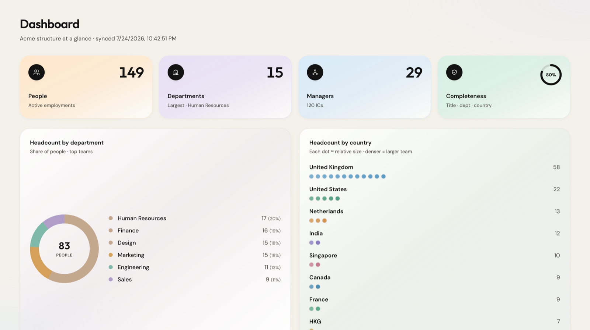
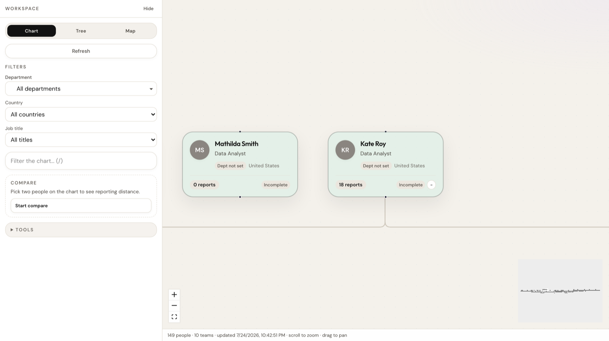
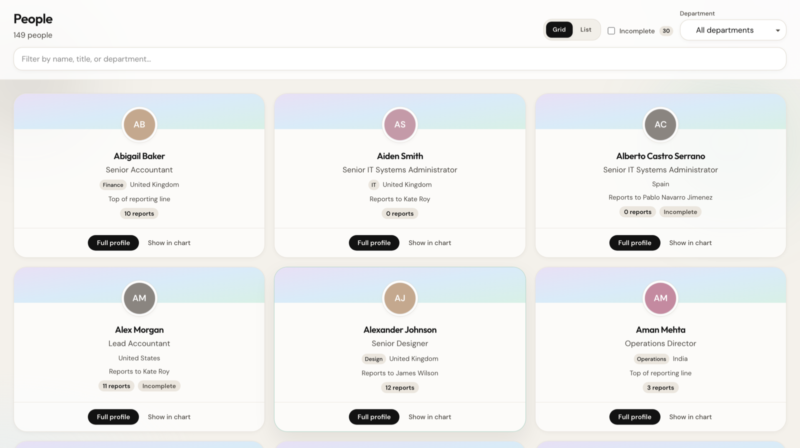

# Remote Org Chart (Acme Sandbox Corp)

Interactive **organisational intelligence** app for **Acme Sandbox Corp**, built against the **Remote sandbox** REST API. Server-side Bearer auth, manager→reports hierarchy, Norma-inspired product chrome, and a public Cloudflare Workers deploy.

## Live demo

**https://remote-org-chart.shirechiko.workers.dev**

Demo login credentials are shared **separately** with the interview team (private handoff / email). Not stored in this README. Override locally or in Wrangler with `DEMO_APP_EMAIL` / `DEMO_APP_PASSWORD` / `APP_SESSION_SECRET`. The app session is separate from `REMOTE_API_TOKEN` (server-only).

| Check | Expected |
|-------|----------|
| Home `/` | Marketing landing with Log in |
| Login | Demo credentials (shared privately) → `/app/dashboard` |
| Product shell | Dashboard · Org Chart · People · header Health / Help / Settings |
| `/api/health/remote` | `{ "ok": true, "remote": "reachable", … }` |
| `/api/org-chart` | Hierarchy JSON (emails stripped); **KV-cached** (1h TTL); cold rebuild ~8–10s via enrich Worker |
| `/api/org-chart?refresh=1` | Bypass cache, rewrite snapshot from Remote |

> First load of `/api/org-chart` fans out employment detail fetches (list responses omit manager IDs). Give it a moment on a cold Worker. Later loads usually hit **Cloudflare KV** (`lastSyncedAt` in the UI). Use **Refresh from Remote** on Org Chart, Dashboard, or Data Health to force a rebuild. Marketing and login pages prefetch `/api/org-chart` so the snapshot is often warm before you enter the app.

### Product screenshots

| Dashboard | Org Chart | People |
|-----------|-----------|--------|
|  |  |  |

### Links for the interview team

- **Live app:** https://remote-org-chart.shirechiko.workers.dev  
- **Marketing landing:** https://remote-org-chart.shirechiko.workers.dev/  
- **Source:** https://github.com/chikoshire/remote-org-chart  
- **In-app Help:** `/help` (after login) · markdown source in [`docs/help/`](./docs/help/)  
- **Security notes:** [SECURITY.md](./SECURITY.md)  
- **Production readiness:** [PRODUCTION.md](./PRODUCTION.md)  
- **Decision log:** [DECISIONS.md](./DECISIONS.md)

---

## What it does

1. Authenticates to Remote sandbox with a **read-only** customer token (`ra_test_…`), **server-side only**
2. Paginates `GET /v1/employments`, then enriches each employment for `manager_employment_id`
3. Builds a manager→reports forest (cycles / orphan managers surfaced as warnings and badges)
4. Renders an interactive Org Chart (name, title, department, country, reporting edges) plus optional Tree list
5. Product surfaces: Dashboard insights, People directory, Departments, Data Health
6. Search focuses a person and their path to root; pan/zoom works on desktop and mobile
7. Shareable deep links (`/app?person=<employmentId>`) select, center, and highlight path-to-root. **Copy link** in the person drawer
8. Command bar (⌘K / Ctrl+K) for people search and route jumps
9. Soft morph + bloom navigation (View Transitions where supported; respects reduced motion)
10. **KV snapshot cache** (1h TTL) + **Refresh from Remote** (keeps prior chart if refresh fails)
11. Demo app login / logout on a marketing landing; Connect wizard in Settings (no secrets in the browser)

### Product map (after login)

| Route | Surface |
|-------|---------|
| `/app/dashboard` | Organisational insights (incl. headcount by department) |
| `/app` | Org Chart (Chart \| Tree \| Map) |
| `/app/people` | People directory (Grid \| List + department filter) |
| `/app/departments` | Redirects to Dashboard |
| `/app/data-health` | Redirects to header Health (`/settings/data-health`) |
| `/help` | Product how-tos + assistant entry |
| `/settings` | Preferences (Remote connect + theme + session) |
| `/settings/data-health` | Data Health (open via header **Health**) |

### Keyboard shortcuts

| Key | Action |
|-----|--------|
| `⌘K` / `Ctrl+K` | Open command bar |
| `/` | Focus people search (Org Chart) |
| `↑` | Select manager |
| `↓` | Select first direct report |
| `←` / `→` | Previous / next sibling |
| `Esc` | Clear search, then clear selection |

---

## Quick start (local)

**Requirements:** Node 20+, a Remote sandbox API token with employment read access.

```bash
git clone https://github.com/chikoshire/remote-org-chart.git
cd remote-org-chart
npm install
cp .env.example .env.local
# Edit .env.local and paste your ra_test_… token
npm run dev
```

Open [http://localhost:3000](http://localhost:3000).

| Script | Purpose |
|--------|---------|
| `npm run dev` | Next.js local server |
| `npm test` | Vitest (hierarchy, redaction, schema) |
| `npm run test:e2e` | Playwright smoke (fixture-mocked `/api/org-chart`) |
| `npm run build` | Production Next build |
| `npm run deploy` | OpenNext → Cloudflare Workers |
| `npm run dev:tunnel` | Local Next + cloudflared public URL (optional) |

### Environment

```bash
REMOTE_API_TOKEN=ra_test_…
REMOTE_API_BASE_URL=https://gateway.remote-sandbox.com
# Optional app login overrides (set real values locally / as Wrangler secrets. Never commit)
# DEMO_APP_EMAIL=
# DEMO_APP_PASSWORD=
# APP_SESSION_SECRET=
```

Token source: sandbox Company settings → Integrations & APIs → Remote API (read-only).  
**Never** commit `.env.local` or paste tokens into issues/PRs.

Secrets gate: `npm run check:secrets` (also installed as a git pre-commit hook via `npm run hooks:install` / `prepare`).

---

## Architecture

```
Browser  →  Next.js /api/*  →  gateway.remote-sandbox.com
              │
              ├─ /api/health/remote     smoke Remote reachability
              ├─ /api/employments       count + redacted sample (dev)
              ├─ /api/org-chart         forest JSON for the UI
              └─ /api/org-chart/enrich-batch
                                        internal fan-out (Workers Free)
```

| Layer | Location | Role |
|-------|----------|------|
| Remote client | `src/lib/remote/` | Env, Bearer fetch, Zod schemas, PII redaction |
| Hierarchy | `src/lib/org/` | `buildOrgForest`, Dagre layout helpers, search, health |
| Auth | `src/lib/auth/` + middleware | Demo session cookie for `/app/*` and `/settings` |
| UI | `src/components/` | Product shell, chart, People, Departments, Data Health |
| Chart page | `src/app/app/` | Authenticated Org Intelligence routes |

**Data note:** `GET /v1/employments` list items do **not** include manager fields. Hierarchy requires `GET /v1/employments/:id` per active employment.

**Cloudflare Free constraint:** Workers allow **50 subrequests** and **6 concurrent outbound connections** per invocation. Production fans enrichment to a dedicated Worker (`remote-org-chart-enrich` via `ORG_ENRICH`, batches of 12, up to 6 siblings) so each batch gets its own connection pool. Gated by `x-org-enrich-secret` (same value as the server token. Never exposed to the browser).

---

## Assumptions and limitations

| Assumption / limit | Why it matters |
|--------------------|----------------|
| `GET /v1/employments` list items omit manager fields | Hierarchy needs `GET /v1/employments/:id` per active employment (~149 in Acme sandbox) |
| Workers Free: 6 concurrent outbound connections / 50 subrequests per invocation | Cold rebuilds fan out to dedicated `remote-org-chart-enrich` Worker (`ORG_ENRICH`); same-URL self-fetch is blocked (error 1042) |
| KV snapshot cache (1h TTL) | Normal loads and marketing/login prefetch are usually cache hits; `?refresh=1` forces a full Remote rebuild |
| Demo login ≠ Remote token | App session cookie is separate; `REMOTE_API_TOKEN` stays server-side only |
| No second employee database | Remote sandbox remains source of truth; overlays/writes use optional `REMOTE_API_WRITE_TOKEN` when set |
| Repo ships without demo passwords | Credentials are Wrangler / `.env.local` only — shared privately with interviewers |

---

## Edge cases (UI)

| Situation | Behavior |
|-----------|----------|
| Missing title / department / country | **Incomplete** badge; fields show as **Not set** |
| Orphan manager ID | **Unlinked** badge; listed on Data Health |
| Reporting cycles | **Cycle** badge; listed on Data Health |
| Empty active set | Empty state copy |
| Remote / network errors | Error surface with retryable vs fatal mapping |
| Auth / rate limit | Mapped to chart error codes (retryable where appropriate) |

---

## Security

- Token only in server routes / Wrangler **secrets**. Never in client bundles
- Browser talks **only** to same-origin `/api/*`
- `/api/org-chart` strips work emails from the payload
- Chart UI shows name / title / department / country. Not emails or addresses
- Demo login session is separate from the Remote API token
- See [SECURITY.md](./SECURITY.md) for the checklist

---

## Stack (and why)

| Choice | Why |
|--------|-----|
| **Next.js + TypeScript** | App Router keeps the token off the client; typed Remote contracts |
| **Tailwind + Norma tokens** | Matches sandbox product chrome (Royal `#624DE3`, Prussian `#00234B`, Spray `#75E8F0`) |
| **React Flow + Dagre** | Interactive pan/zoom + hierarchical layout |
| **Zod** | Runtime validation of Remote JSON |
| **Vitest + Playwright** | Unit + fixture-mocked smoke without live sandbox flakiness |
| **Cloudflare Workers (OpenNext + Wrangler)** | Public host with secrets; brief’s Vercel mention is a suggestion, not a requirement |

Supabase is **off** by default. Remote is the source of truth. Stretch ideas for KV/D1/webhooks live in [DECISIONS.md](./DECISIONS.md) and the issue backlog.

---

## Deploy (Cloudflare)

```bash
# One-time: wrangler login, then set secrets on both Workers
npx wrangler secret put REMOTE_API_TOKEN
npx wrangler secret put REMOTE_API_TOKEN -c workers/org-enrich/wrangler.jsonc

npm run deploy:all   # enrich Worker + OpenNext app
# or: npm run deploy:enrich && npm run deploy
```

`wrangler.jsonc` sets `REMOTE_API_BASE_URL`, `ORG_ENRICH` → `remote-org-chart-enrich`, and `WORKER_SELF`.  
Public URL pattern: `https://remote-org-chart.<account>.workers.dev`

---

## Brand

- Royal Blue `#624DE3` · Prussian Blue `#00234B` · Spray `#75E8F0`
- Design system nickname: **Norma**: sandbox product chrome, not marketing site

---

## Tracking / backlog

| Surface | Purpose |
|---------|---------|
| [GitHub Issues](https://github.com/chikoshire/remote-org-chart/issues?q=is%3Aissue) | Canonical backlog (parents closed on `main`) |
| [ISSUES.md](./ISSUES.md) | Historical serial build order (mirrors `GH#N`) |
| [DECISIONS.md](./DECISIONS.md) | Living “why we chose X” log |

Core brief: Tier 0 chart + deploy. **Org Intelligence wow track** (#58-#68, #70) adds product IA, insights, auth, morph polish, and this QA/handoff gate.

---

## Docs / refs

- [Remote developer docs](https://developer.remote.com)
- [Getting started](https://developer.remote.com/docs/getting-started-with-remote)
- [Sandbox UI](https://employ.remote-sandbox.com)
- Gateway: `https://gateway.remote-sandbox.com`
- Demo reference: [remoteoss/remote-api-demo](https://github.com/remoteoss/remote-api-demo)

## License

[MIT](./LICENSE)
